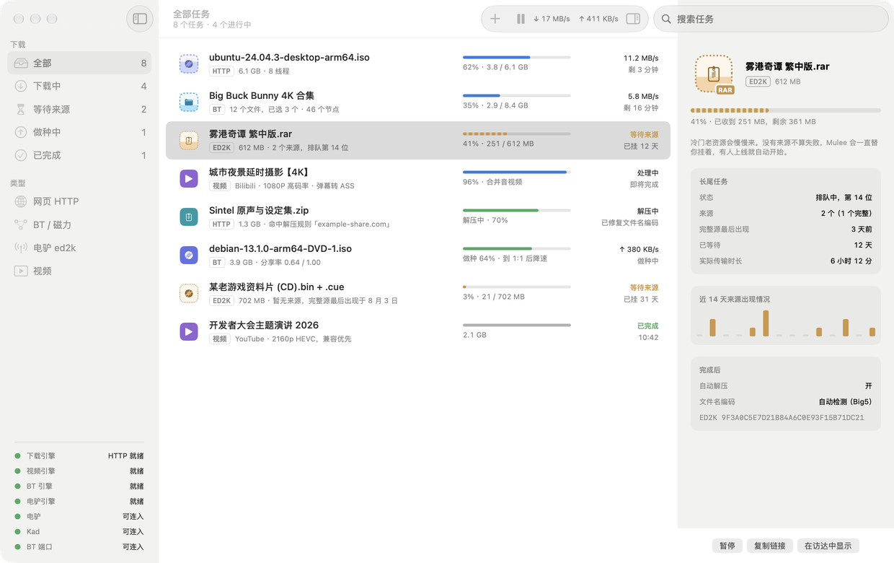
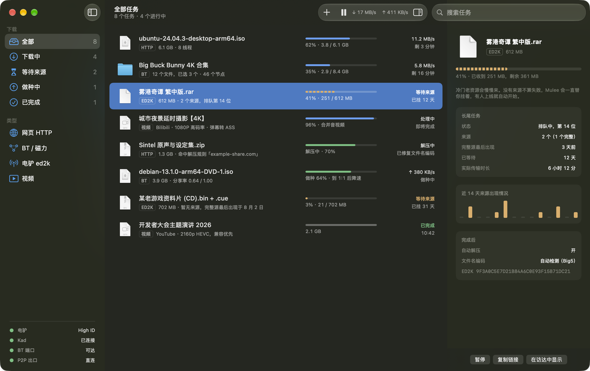
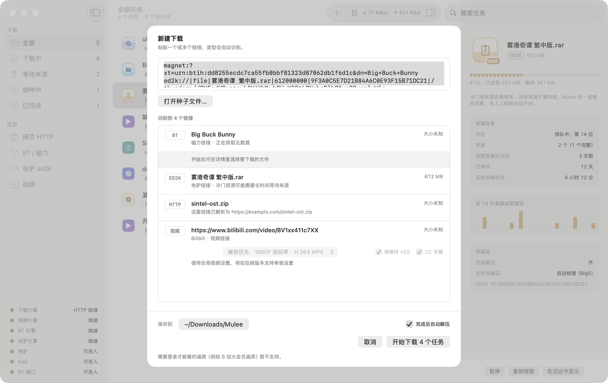
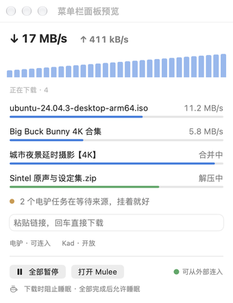
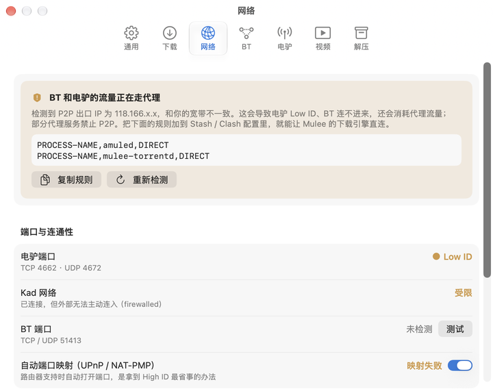

<p align="center"></p>

# Mulee

**一个纯粹的 macOS 下载器。** HTTP、BT / 磁力、ed2k、视频，一个软件全搞定。
开源，免费，永不加广告。

> 🚧 早期版本（0.1.x），欢迎试用和反馈。现在已经可用：
> - **HTTP / HTTPS / FTP**：aria2 引擎，多线程、断点续传、重启后自动恢复
> - **BT / 磁力 / .torrent**：libtorrent 引擎，可选择要下载的文件，默认做种到分享率 1:1 后降速（私有种子可不受限）
> - **电驴 ed2k**：aMule 引擎，长期挂着等冷门资源，显示来源、排队名次和近 14 天来源情况
> - **视频**：yt-dlp，已实测 Bilibili；yt-dlp、Deno、ffmpeg 由 Mulee 自己下载并校验；B 站弹幕自动转成 ASS 字幕
> - **自动解压**：规则密码存在钥匙串里，自动修复 GBK / Big5 / Shift-JIS 文件名乱码
> - **网络诊断**：讲清楚「P2P 是否被代理软件接管」「端口能否从外部连入」，给出可复制的代理规则和端口转发说明
> - 可设为 magnet / ed2k / thunder / .torrent 的默认打开程序；Chrome / Safari 扩展把网页上的链接交给 Mulee（见[浏览器扩展说明](docs/BROWSER-EXTENSION.md)）
> - 简体中文、繁體中文、English
>
> 三个下载引擎都从固定版本的源码编译进 App，只依赖系统库，不需要另装任何东西。从源码构建需要的工具见 [docs/BUILDING.md](docs/BUILDING.md)。



<details>
<summary>更多截图：暗色模式、新建下载、菜单栏、设置</summary>






</details>

[English](#english)

---

## 为什么做 Mulee

在 Mac 上下载东西，往往要装好几个软件：一个管 HTTP，一个管 BT，一个管驴子，一个下视频……
每个软件都有自己的界面和设置，功能有的缺、有的重复，有的还带广告。

Mulee 想把这些合成一个：**一个入口、一套设置、一个下载队列。**

## 计划支持

| 类型 | 说明 |
|---|---|
| HTTP / HTTPS / FTP | 多线程分段下载，断点续传 |
| BT / 磁力链接 | 选择文件下载，可设置做种策略（默认分享率 1:1） |
| ed2k（电驴） | 原生支持，老资源可以长期挂着慢慢等 |
| 迅雷链接 `thunder://` | 自动解析出原始链接，交给对应的下载引擎 |
| 视频 | 基于 [yt-dlp](https://github.com/yt-dlp/yt-dlp)，重点保障 YouTube 和 Bilibili |
| 自动解压 | 下载完成后自动解压，支持按规则自动填密码，修复 GBK / Big5 等编码的文件名乱码 |

以及：

- Swift 原生界面，只支持 Apple Silicon
- 菜单栏常驻，显示实时速度
- 浏览器扩展（Safari / Chrome）
- 可设为 `magnet:` / `ed2k:` / `thunder:` / `.torrent` 的默认打开程序
- 下载时防止系统睡眠
- 多语言界面

## 不做什么

为了让 Mulee 保持专注，以下内容**不在计划内**：

- ❌ 广告，任何形式都不会有
- ❌ 内置资源搜索、资源推荐或种子站。Mulee 只是一个下载工具
- ❌ 迅雷加速网络（P2SP）。迅雷链接只做解析
- ❌ Windows / Linux 版本

## 从源码构建

需要 macOS 26+、Xcode 27+ 和 [XcodeGen](https://github.com/yonaskolb/XcodeGen)（`brew install xcodegen`）。

```sh
brew install cmake boost autoconf automake libtool gettext pkgconf
git submodule update --init --recursive
xcodegen generate
xcodebuild -project Mulee.xcodeproj -scheme Mulee -destination 'platform=macOS' build
```

参与开发前请先读 [docs/CONVENTIONS.md](docs/CONVENTIONS.md)。品牌与图标规范见 [Design/BRAND.md](Design/BRAND.md)、[Design/ICONS.md](Design/ICONS.md)。

## 许可证

[GPL-3.0](LICENSE)

Mulee 只是一个下载工具，请只下载你有权获取的内容。

---

<a id="english"></a>

## English

**Mulee is a no-nonsense download manager for macOS.** HTTP, BitTorrent / magnet, ed2k and video sites, all in one native app.
Open source, free, and never any ads.

> 🚧 Early release (0.1.x). **Working now:** HTTP / HTTPS / FTP (aria2: multi-connection, resume, session restore); BitTorrent, magnet and .torrent (libtorrent: file selection, seeding to a 1:1 share ratio then throttling, private torrents exempt); ed2k (aMule, built for waiting on rare files for weeks); video via yt-dlp (tested with Bilibili; yt-dlp, Deno and ffmpeg are downloaded and verified by Mulee; Bilibili danmaku converted to ASS); auto-extraction with Keychain-stored rule passwords and GBK / Big5 / Shift-JIS filename repair; network diagnostics that explain proxy takeover of P2P traffic and port reachability; default handler for magnet / ed2k / thunder / .torrent; Chrome and Safari extensions ([details](docs/BROWSER-EXTENSION.md)). Available in Simplified Chinese, Traditional Chinese and English. All three engines are compiled from pinned sources into the app and depend only on system libraries; see [docs/BUILDING.md](docs/BUILDING.md) to build from source.

Build on Apple Silicon with macOS 26+, Xcode 27+ and XcodeGen:

```sh
brew install xcodegen cmake boost autoconf automake libtool gettext pkgconf
git submodule update --init --recursive
xcodegen generate
xcodebuild -project Mulee.xcodeproj -scheme Mulee -destination 'platform=macOS' build
```

**Planned:** multi-connection HTTP/FTP, BitTorrent and magnet links, native ed2k, `thunder://` link decoding, video downloads powered by yt-dlp (YouTube and Bilibili first), and auto-extraction with password rules and filename encoding repair. Native Swift UI for Apple Silicon, a menu bar item, browser extensions, default handler for magnet / ed2k / thunder / .torrent, and sleep prevention while downloading.

**Not planned:** ads, built-in resource search, Xunlei's P2SP acceleration network, Windows or Linux builds.

Chrome and Safari extensions send selected download links to Mulee on this Mac for confirmation; see the [browser extension guide](docs/BROWSER-EXTENSION.md) for installation and permissions.

Licensed under [GPL-3.0](LICENSE). Please only download content you have the right to access.

---

Made with ❤️ by [CQAGC](https://www.cqagc.com)
