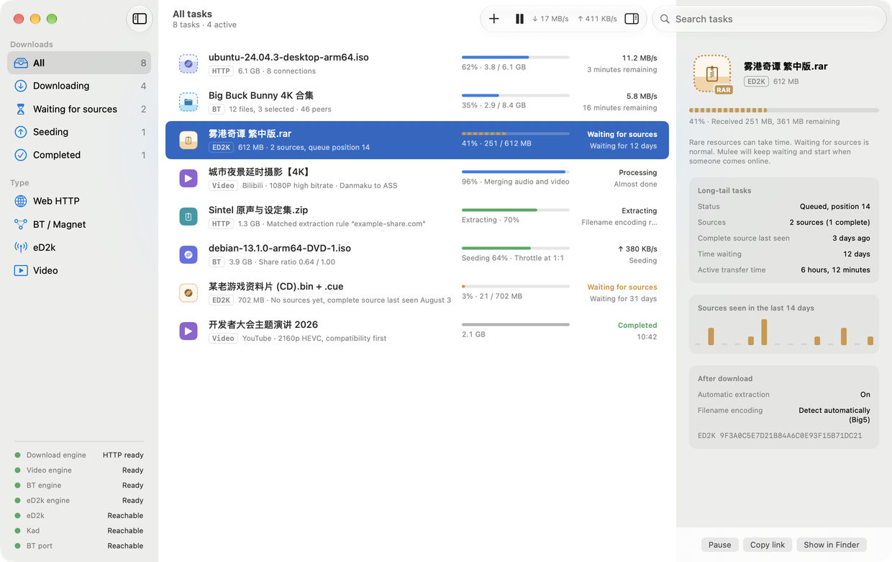
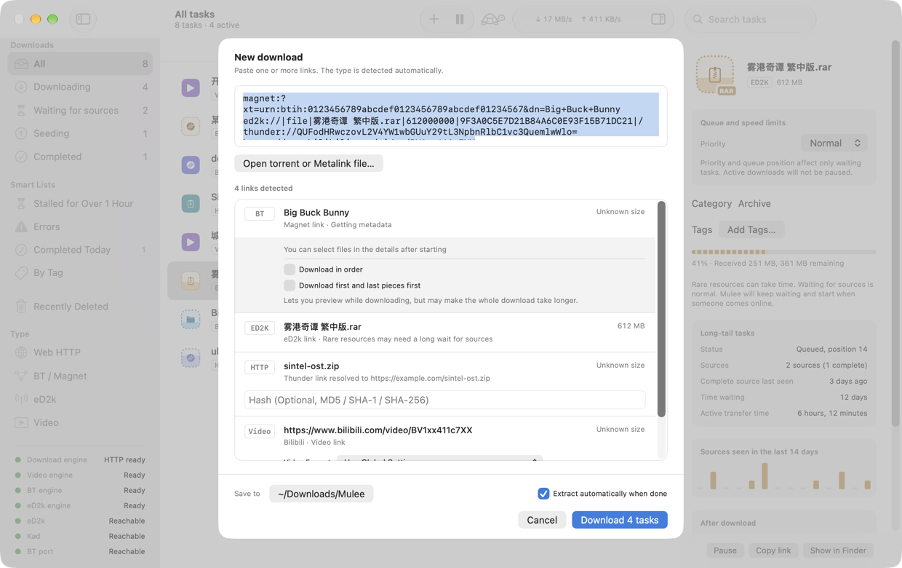
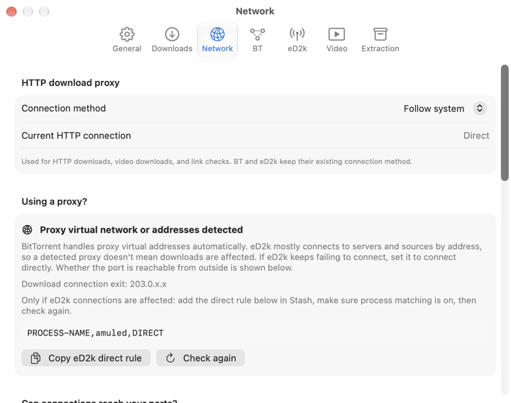
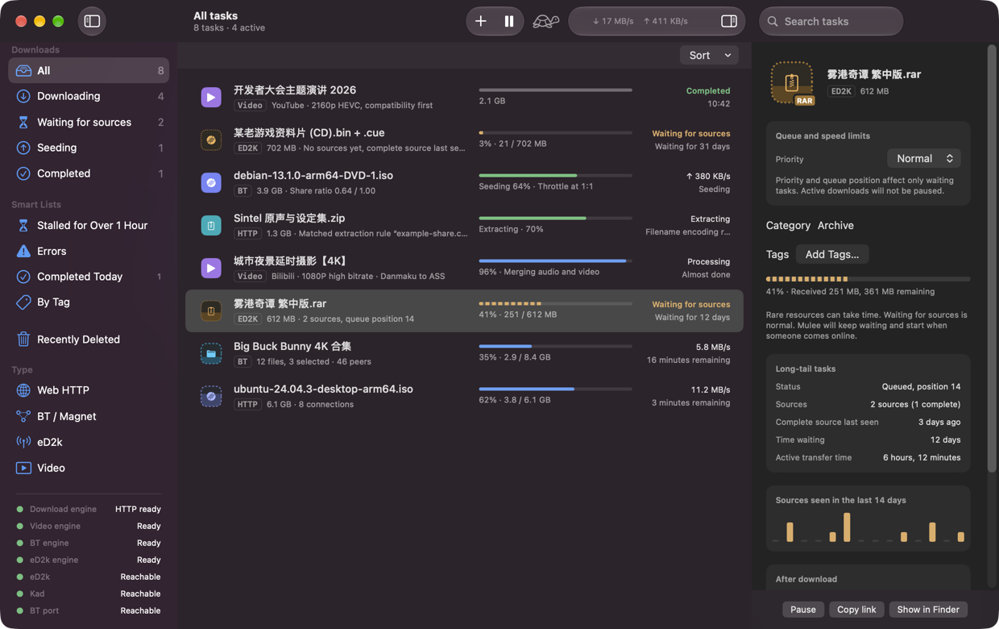
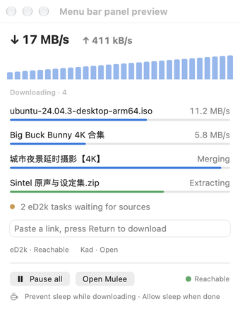

<div align="center">


# Mulee

**A native macOS download manager for HTTP, BitTorrent, eD2k, and video.**

<p align="center">
  <strong>English</strong> |
  <a href="README.zh_CN.md">简体中文</a> |
  <a href="README.zh_TW.md">繁體中文</a>
</p>

<p align="center">
  <a href="LICENSE">
    
  </a>
  <a href="https://github.com/cqagc/mulee/releases/latest">
    
  </a>
  
  
</p>

<p align="center">
  <a href="#description">Project description</a> •
  <a href="#screenshots">Screenshots</a> •
  <a href="#capabilities">Capabilities</a> •
  <a href="#quick-start">Quick start</a> •
  <a href="#development">Development</a> •
  <a href="#documentation">Documentation & community</a> •
  <a href="#upstream">Upstream projects</a> •
  <a href="#license">License</a> •
  <a href="#star-history">Star History</a>
</p>

</div>

<p align="center">
  <a href="docs/screenshots/main.en.png">
    
  </a>
</p>

---

<a id="description"></a>

## 📝 Project description

Mulee brings HTTP / HTTPS / FTP, BitTorrent and magnet links, eD2k, and video downloads into one native Mac app, with one queue and one set of settings. It is open source, free to use, and will never include ads.

Mulee supports **Apple Silicon Macs running macOS 26 or later**. The app is available in English, Simplified Chinese, and Traditional Chinese.

> [!IMPORTANT]
> Mulee is a download tool. Only download content you have the right to access. Mulee does not include resource search.

> [!NOTE]
> Mulee is an early release in the 0.1.x series. The current project version is **0.1.3**.

---

<a id="screenshots"></a>

## Screenshots

All tasks shown are sample data. Click an image to view it at full size.

| New download | Network diagnostics |
|---|---|
| [](docs/screenshots/new-task.en.png) | [](docs/screenshots/settings-network.en.png) |
| **Dark mode** | **Menu bar** |
| [](docs/screenshots/main-dark.en.png) | [](docs/screenshots/menu-bar.en.png) |

---

<a id="capabilities"></a>

## Capabilities

| Capability | What it does |
|---|---|
| HTTP / HTTPS / FTP | aria2 handles multi-connection downloads, resuming, and restoring tasks after a restart. |
| BitTorrent / magnet / .torrent | libtorrent 2.0 supports file selection and seeding policies: throttle or stop at a 1:1 share ratio, with an optional exemption for private torrents. |
| eD2k | aMule 3.1 (`amuled`) keeps rare files waiting for sources for weeks if needed. See queue position, source counts, when a complete source was last seen, and source activity over the past 14 days. Waiting without progress is a normal state. |
| Video | yt-dlp powers downloads with a focus on Bilibili and YouTube. Bilibili danmaku can be converted to ASS subtitles. Mulee downloads and verifies yt-dlp, Deno, and ffmpeg itself. |
| Thunder links | Decodes `thunder://` links and passes the original URL to the appropriate engine. No Xunlei P2SP acceleration. |
| Automatic extraction | 7-Zip extracts completed downloads, stores password-rule secrets in Keychain, and repairs garbled GBK / Big5 / Shift-JIS filenames. |
| Network diagnostics | Explains whether proxy software is routing P2P traffic and whether listening ports are reachable from outside your network, with copyable Stash / Clash rules and port-forwarding instructions. |
| macOS integration | Default handler for magnet / ed2k / thunder / .torrent, Chrome and Safari extensions, live menu bar speeds, and sleep prevention while downloading. |

The four helpers—`aria2c`, `mulee-torrentd`, `amuled`, and `7zz`—are built from pinned source versions and bundled with the app. Their dynamic dependencies are limited to system libraries. The distributed app is Developer ID signed and notarized by Apple.

### Scope

Mulee does not include ads, built-in resource search or recommendations, torrent indexes, or Xunlei P2SP acceleration. Windows and Linux versions are outside the project's scope.

---

<a id="quick-start"></a>

## Quick start

1. Download the DMG from [GitHub Releases](https://github.com/cqagc/mulee/releases/latest).
2. Open it and drag Mulee into **Applications**.
3. Open Mulee, paste a link or open a `.torrent` file, then confirm the new download.

Optional setup:

- In **Settings → General**, choose Mulee as the default app for magnet / ed2k / thunder links and `.torrent` files.
- Enable the Safari extension or install the Chrome extension from Settings. See the [browser extension guide](docs/BROWSER-EXTENSION.md). Links sent by an extension open the confirmation panel before downloading.
- If you use proxy software, open **Settings → Network** to check P2P routing and incoming connectivity. Copy the Stash / Clash rules as needed:

```text
PROCESS-NAME,amuled,DIRECT
PROCESS-NAME,mulee-torrentd,DIRECT
```

Direct routing alone does not make a port reachable. Follow the port-forwarding instructions in Settings → Network and check the reported incoming connection status.

---

<a id="development"></a>

## Development

See the [build guide](docs/BUILDING.md) for the full process. You need an Apple Silicon Mac, macOS 26 or later, Xcode with macOS 26 support, and these build tools:

```sh
brew install xcodegen cmake boost autoconf automake libtool gettext pkgconf
git clone --recursive https://github.com/cqagc/mulee.git
cd mulee
xcodegen generate
xcodebuild -project Mulee.xcodeproj -scheme Mulee -destination 'platform=macOS' build
```

The first build compiles third-party libraries and can take a while. For an existing clone, initialize its submodules with `git submodule update --init --recursive` before building. Read the [development conventions](docs/CONVENTIONS.md) before contributing.

| Directory | Responsibility |
|---|---|
| `Mulee/` | Native app, interface, and macOS services |
| `Packages/MuleeCore/` | UI-independent models, parsing, and download logic |
| `Helpers/mulee-torrentd/` | BitTorrent helper built on libtorrent |
| `Extensions/` | Shared browser extension code and Chrome packaging |
| `MuleeSafariExtension/` | Safari extension and native messaging handler |
| `scripts/` | Build, packaging, release, and verification scripts |
| `ThirdParty/` | Pinned upstream source submodules |
| `Design/` | Brand assets, icon guidelines, and prototypes |
| `docs/` | Build, extension, terminology, and protocol guides |

---

<a id="documentation"></a>

## Documentation & community

| Resource | Where to go |
|---|---|
| [Build guide](docs/BUILDING.md) | Build tools, helpers, and packaging |
| [Browser extensions](docs/BROWSER-EXTENSION.md) | Chrome / Safari installation, usage, and permissions |
| [Development conventions](docs/CONVENTIONS.md) | Project structure and contribution conventions |
| [Glossary](docs/GLOSSARY.md) | Terminology for translation contributions |
| [BitTorrent helper protocol](docs/TORRENTD-PROTOCOL.md) | Communication between the app and mulee-torrentd |
| [GitHub Issues](https://github.com/cqagc/mulee/issues) | Bug reports and feature requests |

When reporting an issue, include your Mulee version, macOS version, and steps to reproduce it.

---

<a id="upstream"></a>

## 🔗 Upstream projects

Mulee relies on the following upstream projects. Thank you to their maintainers and contributors. License notes refer to the components or builds Mulee uses; the license texts supplied with each component remain authoritative.

| Project | Use in Mulee | License |
|---|---|---|
| [aria2](https://github.com/aria2/aria2) | HTTP / HTTPS / FTP engine | GPL-2.0-or-later |
| [libtorrent](https://github.com/arvidn/libtorrent) | BitTorrent engine for mulee-torrentd | BSD-3-Clause |
| [aMule](https://github.com/amule-org/amule) | eD2k engine (amuled) | GPL-2.0-or-later |
| [yt-dlp](https://github.com/yt-dlp/yt-dlp) | Video downloads | Unlicense (source); bundled macOS executable: GPL-3.0-or-later |
| [FFmpeg (Martin Riedl)](https://ffmpeg.martin-riedl.de/) | Video / audio merging and processing; Martin Riedl builds | GPL-3.0-or-later |
| [Deno](https://github.com/denoland/deno) | JavaScript runtime used by yt-dlp | MIT |
| [7-Zip](https://www.7-zip.org/) | Archive extraction (7zz) | LGPL-2.1-or-later, BSD terms, and unRAR restriction |
| [OpenSSL](https://github.com/openssl/openssl) | Cryptography and TLS for P2P helpers | Apache-2.0 |
| [wxWidgets](https://github.com/wxWidgets/wxWidgets) | Base and networking libraries for amuled | wxWindows Library Licence 3.1 (LGPL with linking exception) |
| [Crypto++](https://github.com/weidai11/cryptopp) | Cryptographic support for amuled | BSL-1.0 for the compilation; individual files are public domain; additional terms in License.txt |
| [Boost](https://www.boost.org/) | C++ headers and Boost.JSON for helpers | BSL-1.0 |

Build and packaging details are recorded in [BUILDING.md](docs/BUILDING.md) and the [build scripts](scripts/). yt-dlp and Deno are downloaded tools; FFmpeg licensing above refers specifically to the selected Martin Riedl build.

---

<a id="license"></a>

## 📜 License

Mulee is licensed under [GPL-3.0](LICENSE). Third-party components retain their own licenses; see the upstream table and the license texts supplied with them.

---

<a id="star-history"></a>

## 🌟 Star History

<div align="center">

[](https://star-history.com/#cqagc/mulee&Date)

</div>

---

<div align="center">

### 💖 Thank you for using Mulee

If Mulee is useful to you, a ⭐ Star is welcome.

**[Download latest](https://github.com/cqagc/mulee/releases/latest)** • **[Report an issue](https://github.com/cqagc/mulee/issues)** • **[Build guide](docs/BUILDING.md)**

Made with ❤️ by [CQAGC](https://www.cqagc.com)

</div>
