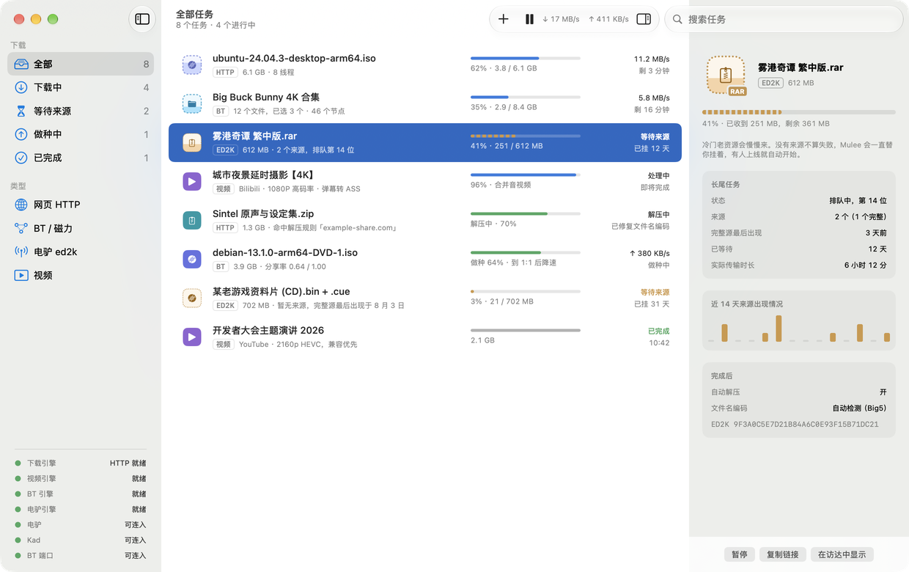
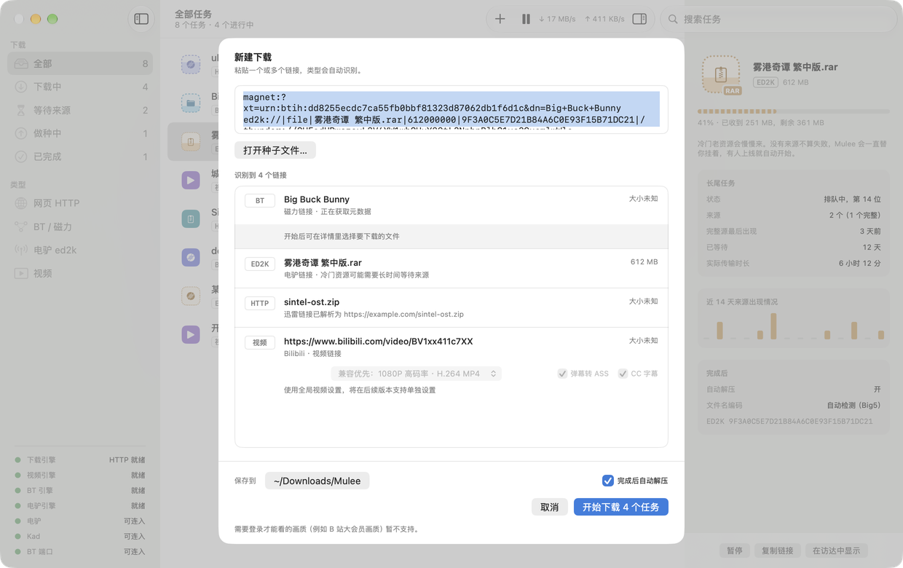
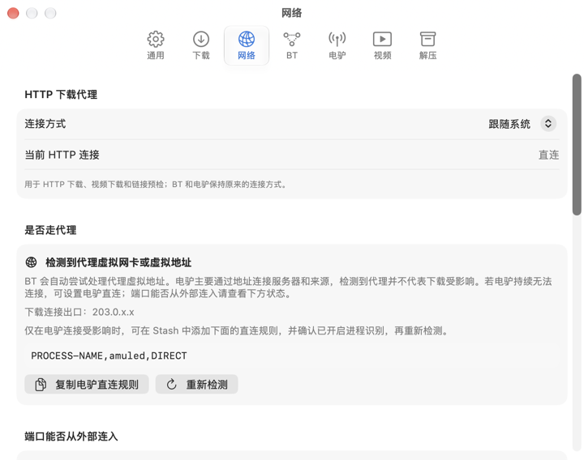
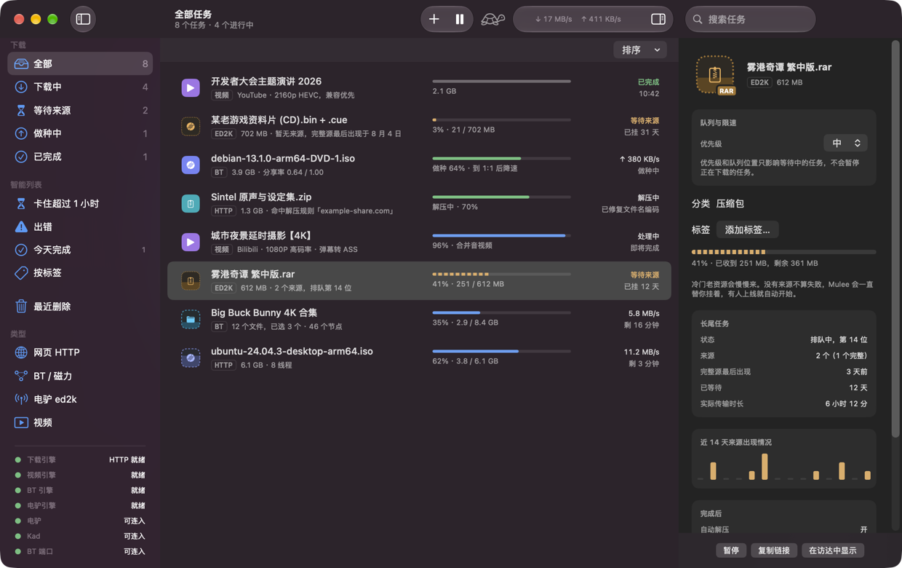
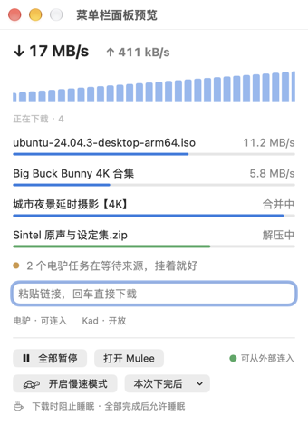

<div align="center">


# Mulee

**macOS 原生下载器，支持 HTTP、BT、电驴和视频下载。**

<p align="center">
  <a href="README.md">English</a> |
  <strong>简体中文</strong> |
  <a href="README.zh_TW.md">繁體中文</a>
</p>

<p align="center">
  <a href="LICENSE">
    
  </a>
  <a href="https://github.com/cqagc/mulee/releases/latest">
    
  </a>
  
  
</p>

<p align="center">
  <a href="#description">项目说明</a> •
  <a href="#screenshots">截图</a> •
  <a href="#capabilities">功能</a> •
  <a href="#quick-start">快速开始</a> •
  <a href="#development">开发</a> •
  <a href="#documentation">文档与社区</a> •
  <a href="#upstream">上游项目</a> •
  <a href="#license">许可证</a> •
  <a href="#star-history">Star History</a>
</p>

</div>

<p align="center">
  <a href="docs/screenshots/main.zh-CN.png">
    
  </a>
</p>

---

<a id="description"></a>

## 📝 项目说明

Mulee 支持 HTTP / HTTPS / FTP、BT / 磁力链接、电驴和视频下载。不同类型的下载共用队列和设置。免费开源，永不加广告。

仅支持 **Apple 芯片、macOS 26 及以上**。界面支持简体中文、繁体中文和英文。

> [!IMPORTANT]
> Mulee 是下载工具，不内置资源搜索。请只下载你有权获取的内容。

> [!NOTE]
> 当前为 0.1.x 早期版本，项目版本是 **0.1.3**。

---

<a id="screenshots"></a>

## 截图

截图中的任务均为示例数据。点击图片可查看原图。

| 新建下载 | 网络诊断 |
|---|---|
| [](docs/screenshots/new-task.zh-CN.png) | [](docs/screenshots/settings-network.zh-CN.png) |
| **暗色模式** | **菜单栏** |
| [](docs/screenshots/main-dark.zh-CN.png) | [](docs/screenshots/menu-bar.zh-CN.png) |

---

<a id="capabilities"></a>

## 功能

| 功能 | 说明 |
|---|---|
| HTTP / HTTPS / FTP | aria2 引擎，多连接下载、断点续传，重启后恢复任务。 |
| BT / 磁力 / .torrent | libtorrent 2.0 引擎，可选择下载文件；分享率达到 1:1 后降速或停止，私有种子可不受此限制。 |
| 电驴 ed2k | 使用 aMule 3.1（`amuled`），冷门资源可以挂几周等待来源。显示排队名次、来源数、完整来源最后出现时间和近 14 天来源记录。等待来源是正常任务状态。 |
| 视频 | 使用 yt-dlp，主要支持 Bilibili / YouTube；B 站弹幕可转为 ASS 字幕。yt-dlp、Deno、ffmpeg 由 Mulee 自行下载并校验。 |
| 迅雷链接 | 解析 `thunder://` 中的原始链接，交给对应引擎；不提供迅雷 P2SP 加速。 |
| 自动解压 | 7-Zip 解压已完成的下载，密码规则中的密码存入钥匙串，修复 GBK / Big5 / Shift-JIS 文件名乱码。 |
| 网络诊断 | 检查 P2P 流量是否经过代理、监听端口能否从外部连入。附有可复制的 Stash / Clash 规则和端口转发说明。 |
| macOS 集成 | 可设为 magnet / ed2k / thunder / .torrent 默认打开程序，提供 Chrome / Safari 扩展、菜单栏实时速度和下载时防止睡眠。 |

App 附带四个辅助程序：`aria2c`、`mulee-torrentd`、`amuled`、`7zz`。它们由固定版本的源码编译，只动态链接系统库。分发的 App 使用 Developer ID 签名，并经过 Apple 公证。

### 项目范围

不加广告，不内置资源搜索、推荐或种子站，不提供迅雷 P2SP 加速，也不做 Windows / Linux 版。

---

<a id="quick-start"></a>

## 快速开始

1. 从 [GitHub Releases](https://github.com/cqagc/mulee/releases/latest) 下载 DMG。
2. 打开 DMG，把 Mulee 拖进「**应用程序**」。
3. 打开 Mulee，粘贴链接或打开 `.torrent` 文件，确认新建下载。

可选设置：

- 在「**设置 → 通用**」中，将 Mulee 设为 magnet / ed2k / thunder 链接和 `.torrent` 文件的默认打开程序。
- 在 Mulee 设置中打开 Safari 扩展设置，或查看 Chrome 扩展安装说明，详见[浏览器扩展说明](docs/BROWSER-EXTENSION.md)。扩展发送的链接会先打开确认面板。
- 使用代理软件时，查看「**设置 → 网络**」中的 P2P 路由和外部连入状态，按需复制 Stash / Clash 规则：

```text
PROCESS-NAME,amuled,DIRECT
PROCESS-NAME,mulee-torrentd,DIRECT
```

直连不等于端口可从外部连入。请按「设置 → 网络」中的说明配置端口转发，并查看连入状态。

---

<a id="development"></a>

## 开发

完整流程见[构建说明](docs/BUILDING.md)。需要 Apple 芯片、macOS 26 及以上、支持 macOS 26 的 Xcode，以及以下构建工具：

```sh
brew install xcodegen cmake boost autoconf automake libtool gettext pkgconf
git clone --recursive https://github.com/cqagc/mulee.git
cd mulee
xcodegen generate
xcodebuild -project Mulee.xcodeproj -scheme Mulee -destination 'platform=macOS' build
```

首次构建需要编译第三方库，耗时较长。如果已经克隆了仓库，先运行 `git submodule update --init --recursive` 初始化子模块，再构建。参与开发前请读[开发约定](docs/CONVENTIONS.md)。

| 目录 | 内容 |
|---|---|
| `Mulee/` | 原生 App、界面与 macOS 服务 |
| `Packages/MuleeCore/` | 不依赖 UI 的模型、解析和下载逻辑 |
| `Helpers/mulee-torrentd/` | 基于 libtorrent 的 BT 辅助进程 |
| `Extensions/` | 浏览器扩展共享代码与 Chrome 打包资源 |
| `MuleeSafariExtension/` | Safari 扩展与原生消息处理 |
| `scripts/` | 构建、打包、发布和校验脚本 |
| `ThirdParty/` | 固定版本的上游源码子模块 |
| `Design/` | 品牌资源、图标规范与原型 |
| `docs/` | 构建、扩展、术语和协议说明 |

---

<a id="documentation"></a>

## 文档与社区

| 资源 | 内容 |
|---|---|
| [构建说明](docs/BUILDING.md) | 构建工具、辅助程序与打包 |
| [浏览器扩展](docs/BROWSER-EXTENSION.md) | Chrome / Safari 安装、使用和权限 |
| [开发约定](docs/CONVENTIONS.md) | 工程结构与贡献约定 |
| [术语表](docs/GLOSSARY.md) | 参与翻译时使用的统一术语 |
| [BT 辅助进程协议](docs/TORRENTD-PROTOCOL.md) | App 与 mulee-torrentd 的通信 |
| [GitHub Issues](https://github.com/cqagc/mulee/issues) | 问题反馈与功能建议 |

反馈时请附上 Mulee 版本、系统版本和复现步骤。

---

<a id="upstream"></a>

## 🔗 上游项目

Mulee 使用以下上游项目，感谢维护者与贡献者。许可证说明对应 Mulee 使用的组件或构建，具体以各组件随附的许可证文本为准。

| 项目 | 用途 | 许可证 |
|---|---|---|
| [aria2](https://github.com/aria2/aria2) | HTTP / HTTPS / FTP 下载引擎 | GPL-2.0-or-later |
| [libtorrent](https://github.com/arvidn/libtorrent) | mulee-torrentd 的 BT 引擎 | BSD-3-Clause |
| [aMule](https://github.com/amule-org/amule) | 电驴引擎（amuled） | GPL-2.0-or-later |
| [yt-dlp](https://github.com/yt-dlp/yt-dlp) | 视频下载 | 源码为 Unlicense；打包的 macOS 可执行文件为 GPL-3.0-or-later |
| [FFmpeg (Martin Riedl)](https://ffmpeg.martin-riedl.de/) | 音视频合并与处理，使用 Martin Riedl 构建 | GPL-3.0-or-later |
| [Deno](https://github.com/denoland/deno) | yt-dlp 使用的 JavaScript 运行时 | MIT |
| [7-Zip](https://www.7-zip.org/) | 压缩包解压（7zz） | LGPL-2.1-or-later、BSD 条款及 unRAR 限制 |
| [OpenSSL](https://github.com/openssl/openssl) | P2P 辅助程序的加密与 TLS | Apache-2.0 |
| [wxWidgets](https://github.com/wxWidgets/wxWidgets) | amuled 的基础与网络库 | wxWindows Library Licence 3.1（LGPL 附链接例外） |
| [Crypto++](https://github.com/weidai11/cryptopp) | amuled 的密码学支持 | 整体库为 BSL-1.0，单个文件为公有领域；其他条款见 License.txt |
| [Boost](https://www.boost.org/) | 辅助程序使用的 C++ 头文件与 Boost.JSON | BSL-1.0 |

构建与许可证打包细节见 [BUILDING.md](docs/BUILDING.md) 和[构建脚本](scripts/)。yt-dlp、Deno 为下载的工具；上表的 FFmpeg 许可证特指选用的 Martin Riedl 构建。

---

<a id="license"></a>

## 📜 许可证

Mulee 采用 [GPL-3.0](LICENSE) 许可证。第三方组件保留各自的许可证，详见上游表及随组件提供的许可证文本。

---

<a id="star-history"></a>

## 🌟 Star History

<div align="center">

[](https://star-history.com/#cqagc/mulee&Date)

</div>

---

<div align="center">

### 致谢

觉得 Mulee 好用的话，欢迎点个 Star。

**[下载最新版](https://github.com/cqagc/mulee/releases/latest)** • **[问题反馈](https://github.com/cqagc/mulee/issues)** • **[构建说明](docs/BUILDING.md)**

由 [CQAGC](https://www.cqagc.com) 维护

</div>
