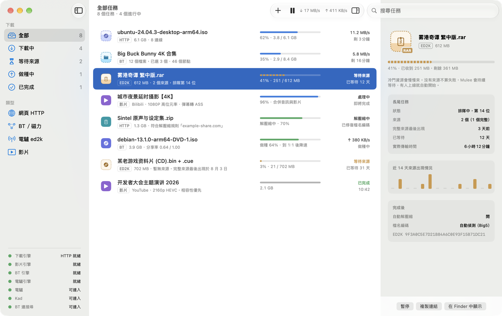
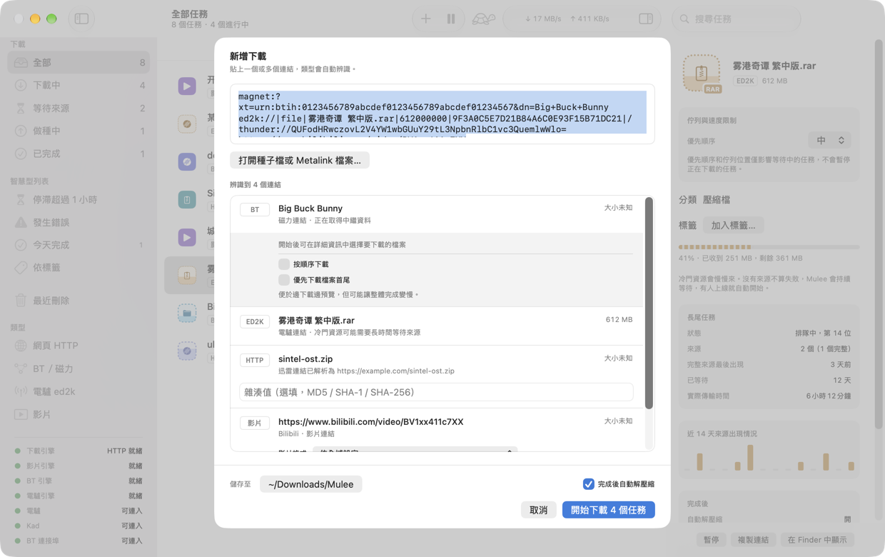
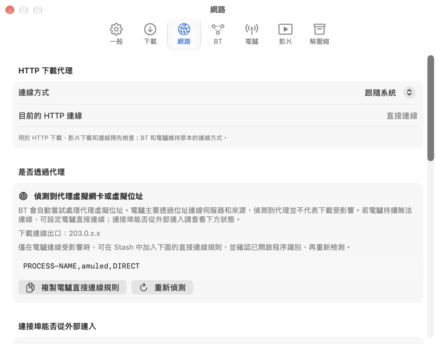
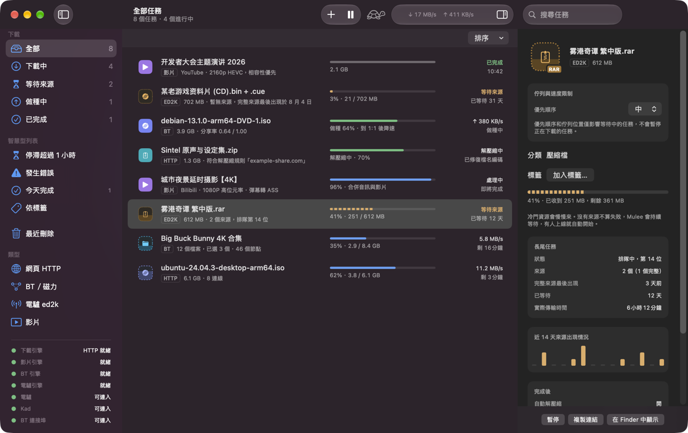
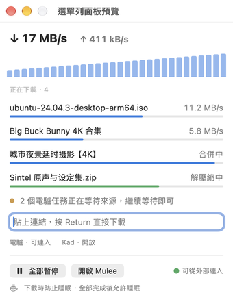

<div align="center">


# Mulee

**一個 macOS 原生下載工具，統一管理 HTTP、BT、電驢和影片下載。**

<p align="center">
  <a href="README.md">English</a> |
  <a href="README.zh_CN.md">简体中文</a> |
  <strong>繁體中文</strong>
</p>

<p align="center">
  <a href="LICENSE">
    
  </a>
  <a href="https://github.com/cqagc/mulee/releases/latest">
    
  </a>
  
  
</p>

<p align="center">
  <a href="#description">專案說明</a> •
  <a href="#screenshots">專案截圖</a> •
  <a href="#capabilities">核心功能</a> •
  <a href="#quick-start">快速開始</a> •
  <a href="#development">開發</a> •
  <a href="#documentation">文件與社群</a> •
  <a href="#upstream">上游專案</a> •
  <a href="#license">授權條款</a> •
  <a href="#star-history">Star History</a>
</p>

</div>

<p align="center">
  <a href="docs/screenshots/main.zh-TW.png">
    
  </a>
</p>

---

<a id="description"></a>

## 📝 專案說明

Mulee 將 HTTP / HTTPS / FTP、BT / 磁力連結、電驢和影片下載整合到一個原生 Mac App：一個入口、一套設定、一個下載佇列。開放原始碼、免費，永遠不加廣告。

僅支援 **Apple 晶片、macOS 26 以上版本**。介面提供繁體中文、简体中文和 English。

> [!IMPORTANT]
> Mulee 只是下載工具，請只下載你有權取得的內容。不內建任何資源搜尋。

> [!NOTE]
> 目前為 0.1.x 早期版本，專案版本是 **0.1.3**。

---

<a id="screenshots"></a>

## 專案截圖

截圖中的任務皆為範例資料。點選圖片可查看原圖。

| 新增下載 | 網路診斷 |
|---|---|
| [](docs/screenshots/new-task.zh-TW.png) | [](docs/screenshots/settings-network.zh-TW.png) |
| **深色模式** | **選單列** |
| [](docs/screenshots/main-dark.zh-TW.png) | [](docs/screenshots/menu-bar.zh-TW.png) |

---

<a id="capabilities"></a>

## 核心功能

| 功能 | 說明 |
|---|---|
| HTTP / HTTPS / FTP | aria2 引擎，多連線下載、續傳，重新啟動後恢復任務。 |
| BT / 磁力 / .torrent | libtorrent 2.0 引擎，可選擇下載檔案；分享率達到 1:1 後降低速度或停止，私有種子可排除限制。 |
| 電驢 ed2k | aMule 3.1（`amuled`）引擎，冷門資源可以持續等待數週。顯示排隊名次、來源數、完整來源最後出現時間和近 14 天來源情況；暫時沒有進度是正常等待。 |
| 影片 | 基於 yt-dlp，著重支援 Bilibili / YouTube；B 站彈幕可轉為 ASS 字幕。yt-dlp、Deno、ffmpeg 由 Mulee 自行下載並驗證。 |
| 迅雷連結 | 解析 `thunder://` 中的原始連結，交給對應引擎；不提供迅雷 P2SP 加速。 |
| 自動解壓縮 | 7-Zip 解壓縮已完成的下載，密碼規則中的密碼存入鑰匙圈，修復 GBK / Big5 / Shift-JIS 檔名亂碼。 |
| 網路診斷 | 說明 P2P 是否被代理軟體接管、監聽連接埠能否從外部連入，提供可複製的 Stash / Clash 規則和連接埠轉送說明。 |
| macOS 整合 | 可設為 magnet / ed2k / thunder / .torrent 預設開啟程式，提供 Chrome / Safari 擴充功能、選單列即時速度和下載時防止睡眠。 |

四個輔助程式 `aria2c`、`mulee-torrentd`、`amuled`、`7zz` 從固定版本原始碼編譯後隨 App 提供，動態相依性僅限系統函式庫。發行的 App 使用 Developer ID 簽署，並通過 Apple 公證。

### 不做什麼

不加廣告，不內建資源搜尋、推薦或種子站，不提供迅雷 P2SP 加速，也不製作 Windows / Linux 版。

---

<a id="quick-start"></a>

## 快速開始

1. 從 [GitHub Releases](https://github.com/cqagc/mulee/releases/latest) 下載 DMG。
2. 開啟 DMG，將 Mulee 拖進「**應用程式**」。
3. 開啟 Mulee，貼上連結或開啟 `.torrent` 檔案，確認新增下載。

選用設定：

- 在「**設定 → 一般**」中，將 Mulee 設為 magnet / ed2k / thunder 連結和 `.torrent` 檔案的預設開啟程式。
- 從設定啟用 Safari 擴充功能或安裝 Chrome 擴充功能，詳見[瀏覽器擴充功能說明](docs/BROWSER-EXTENSION.md)。擴充功能傳送的連結會先開啟確認面板。
- 使用代理軟體時，查看「**設定 → 網路**」中的 P2P 路由和外部連入狀態，視需要複製 Stash / Clash 規則：

```text
PROCESS-NAME,amuled,DIRECT
PROCESS-NAME,mulee-torrentd,DIRECT
```

直接連線不代表連接埠可從外部連入。請依照「設定 → 網路」中的說明設定連接埠轉送，並查看連入狀態。

---

<a id="development"></a>

## 開發

完整流程見[建置說明](docs/BUILDING.md)。需要 Apple 晶片、macOS 26 以上版本、支援 macOS 26 的 Xcode，以及以下建置工具：

```sh
brew install xcodegen cmake boost autoconf automake libtool gettext pkgconf
git clone --recursive https://github.com/cqagc/mulee.git
cd mulee
xcodegen generate
xcodebuild -project Mulee.xcodeproj -scheme Mulee -destination 'platform=macOS' build
```

首次建置需要編譯第三方函式庫，所需時間較長。若已複製儲存庫，可先執行 `git submodule update --init --recursive` 初始化子模組，再建置。參與開發前請閱讀[開發慣例](docs/CONVENTIONS.md)。

| 目錄 | 職責 |
|---|---|
| `Mulee/` | 原生 App、介面與 macOS 服務 |
| `Packages/MuleeCore/` | 不依賴 UI 的模型、解析和下載邏輯 |
| `Helpers/mulee-torrentd/` | 基於 libtorrent 的 BT 輔助行程 |
| `Extensions/` | 瀏覽器擴充功能共用程式碼與 Chrome 封裝資源 |
| `MuleeSafariExtension/` | Safari 擴充功能與原生訊息處理 |
| `scripts/` | 建置、封裝、發行和驗證指令碼 |
| `ThirdParty/` | 固定版本的上游原始碼子模組 |
| `Design/` | 品牌資源、圖示規範與原型 |
| `docs/` | 建置、擴充功能、術語和通訊協定說明 |

---

<a id="documentation"></a>

## 文件與社群

| 資源 | 入口 |
|---|---|
| [建置說明](docs/BUILDING.md) | 建置工具、輔助程式與封裝 |
| [瀏覽器擴充功能](docs/BROWSER-EXTENSION.md) | Chrome / Safari 安裝、使用和權限 |
| [開發慣例](docs/CONVENTIONS.md) | 專案結構與貢獻慣例 |
| [術語表](docs/GLOSSARY.md) | 參與翻譯時使用的統一術語 |
| [BT 輔助行程通訊協定](docs/TORRENTD-PROTOCOL.md) | App 與 mulee-torrentd 的通訊 |
| [GitHub Issues](https://github.com/cqagc/mulee/issues) | 問題回報與功能建議 |

回報問題時請附上 Mulee 版本、系統版本和重現步驟。

---

<a id="upstream"></a>

## 🔗 上游專案

Mulee 使用以下上游專案，感謝維護者與貢獻者。授權說明對應 Mulee 使用的元件或建置版本，詳細內容以各元件隨附的授權文字為準。

| 專案 | 用途 | 授權條款 |
|---|---|---|
| [aria2](https://github.com/aria2/aria2) | HTTP / HTTPS / FTP 下載引擎 | GPL-2.0-or-later |
| [libtorrent](https://github.com/arvidn/libtorrent) | mulee-torrentd 的 BT 引擎 | BSD-3-Clause |
| [aMule](https://github.com/amule-org/amule) | 電驢引擎（amuled） | GPL-2.0-or-later |
| [yt-dlp](https://github.com/yt-dlp/yt-dlp) | 影片下載 | 原始碼為 Unlicense；封裝的 macOS 執行檔為 GPL-3.0-or-later |
| [FFmpeg (Martin Riedl)](https://ffmpeg.martin-riedl.de/) | 影音合併與處理，使用 Martin Riedl 建置版本 | GPL-3.0-or-later |
| [Deno](https://github.com/denoland/deno) | yt-dlp 使用的 JavaScript 執行環境 | MIT |
| [7-Zip](https://www.7-zip.org/) | 壓縮檔解壓縮（7zz） | LGPL-2.1-or-later、BSD 條款及 unRAR 限制 |
| [OpenSSL](https://github.com/openssl/openssl) | P2P 輔助程式的加密與 TLS | Apache-2.0 |
| [wxWidgets](https://github.com/wxWidgets/wxWidgets) | amuled 的基礎與網路函式庫 | wxWindows Library Licence 3.1（LGPL 附連結例外） |
| [Crypto++](https://github.com/weidai11/cryptopp) | amuled 的密碼學支援 | 整體函式庫為 BSL-1.0，個別檔案屬公有領域；其他條款見 License.txt |
| [Boost](https://www.boost.org/) | 輔助程式使用的 C++ 標頭檔與 Boost.JSON | BSL-1.0 |

建置與授權文字封裝細節見 [BUILDING.md](docs/BUILDING.md) 和[建置指令碼](scripts/)。yt-dlp、Deno 為下載的工具；上表的 FFmpeg 授權特指選用的 Martin Riedl 建置版本。

---

<a id="license"></a>

## 📜 授權條款

Mulee 採用 [GPL-3.0](LICENSE) 授權。第三方元件保留各自的授權條款，詳見上游表及隨元件提供的授權文字。

---

<a id="star-history"></a>

## 🌟 Star History

<div align="center">

[](https://star-history.com/#cqagc/mulee&Date)

</div>

---

<div align="center">

### 💖 感謝使用 Mulee

如果 Mulee 對你有幫助，歡迎給專案一個 ⭐ Star。

**[下載最新版](https://github.com/cqagc/mulee/releases/latest)** • **[問題回報](https://github.com/cqagc/mulee/issues)** • **[建置說明](docs/BUILDING.md)**

Made with ❤️ by [CQAGC](https://www.cqagc.com)

</div>
